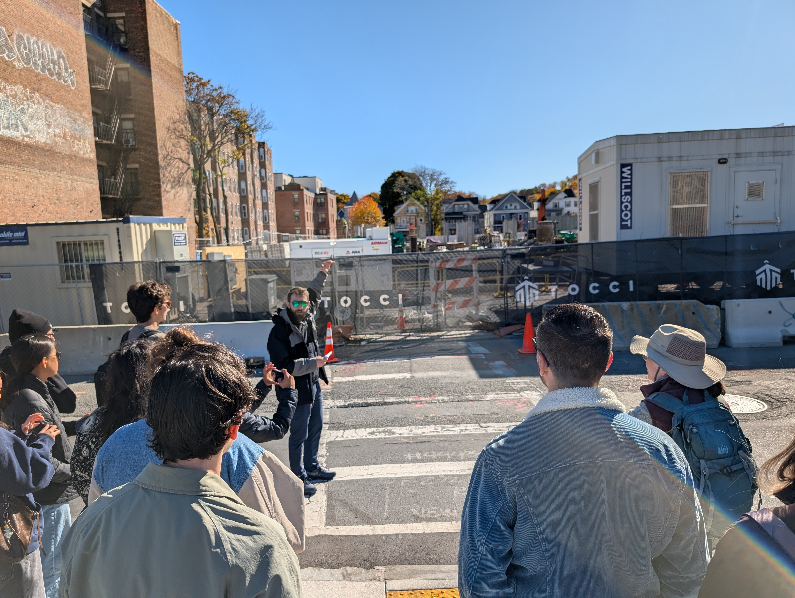
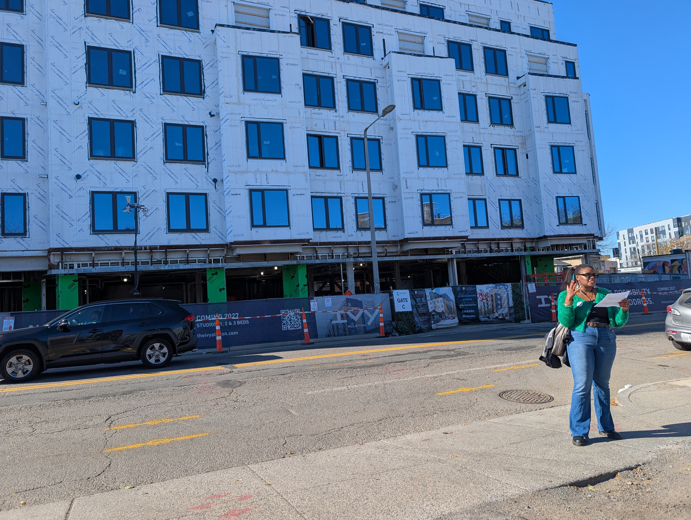
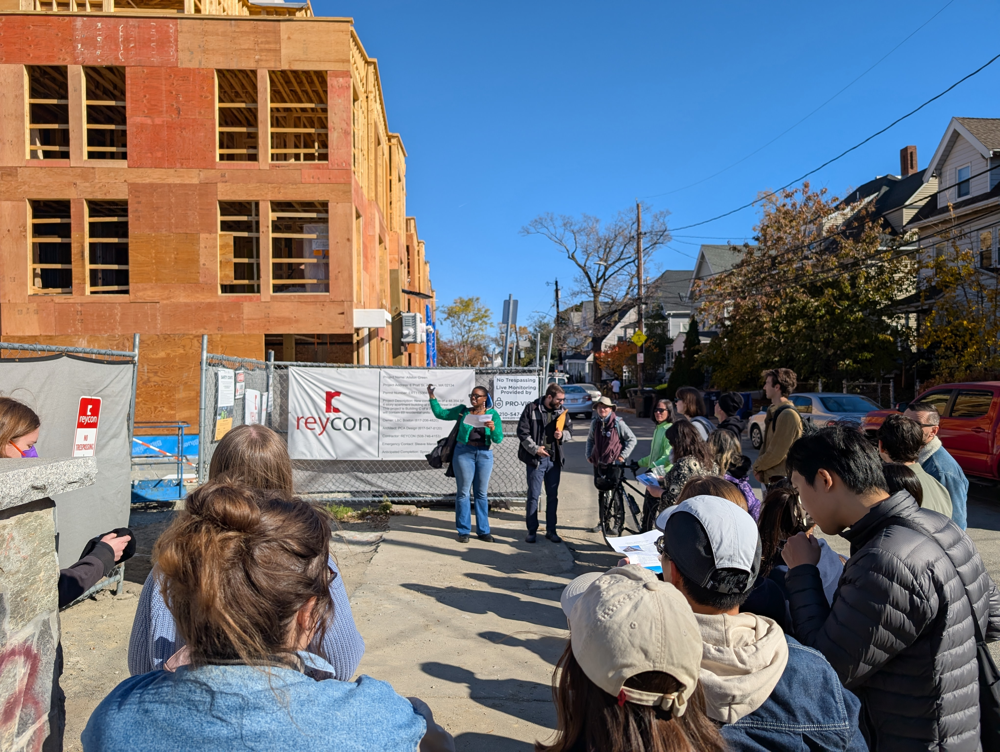
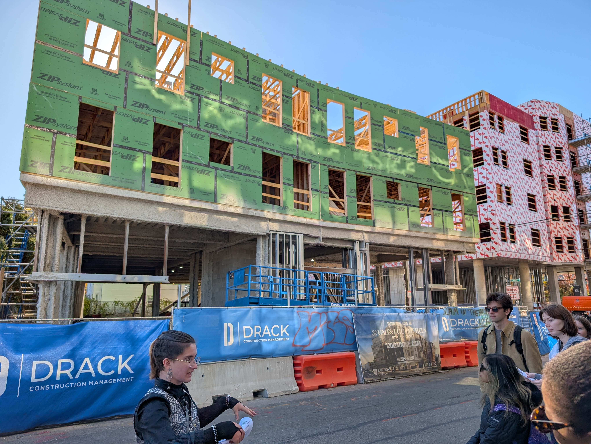
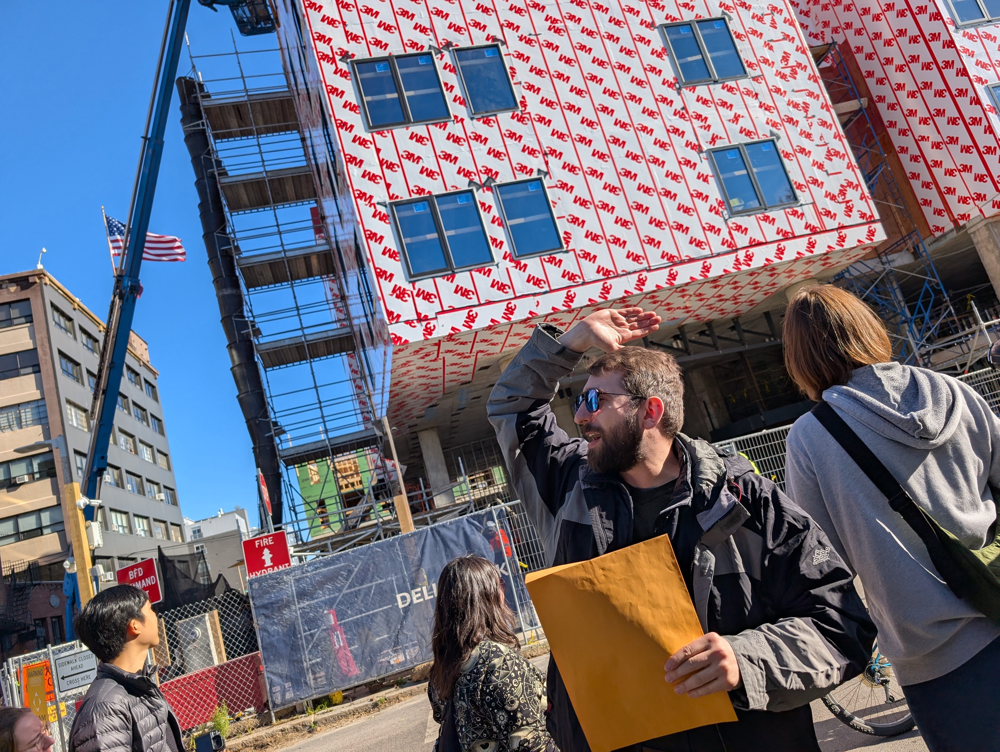
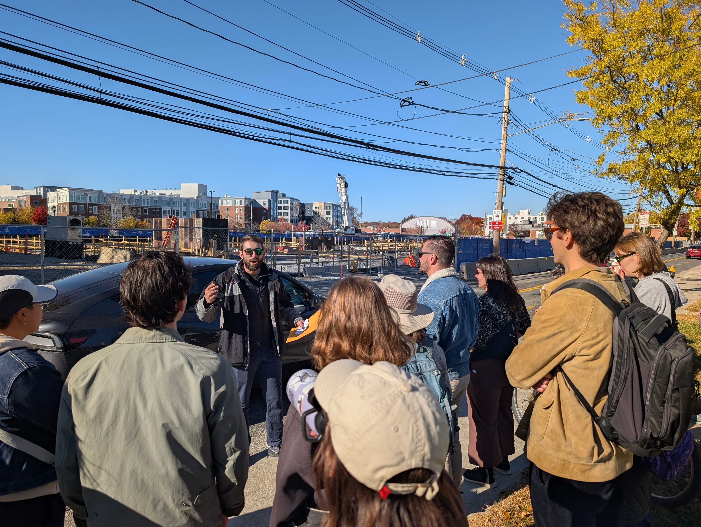

# Tour Notes

### 1270 Commonwealth Avenue ("Arborline")

- 5 stories of wood-frame construction over a 1-story steel podium
- 206 units, 70 ground level parking spaces (.34 ratio)
- Developer is Hines along with Benenson Capital Partners, general contractor is Tocci
- Project filed in 2022, approved in 2023
- Mostly finished with excavation, currently working on footings/foundation and first floor columns

### 25-39 Harvard Avenue ("The Ivy", formerly "Allston Post")

- 5 stories of wood-frame construction over a 1-story steel podium
- 170 units, 58 ground level parking spaces (.34 ratio)
- Developer is Eden Properties, GC is Cranshaw
- Project filed and approved in 2023, target completion in June 2027
- Framing is complete, windows almost in, moisture barrier being applied
- Going to add street trees
- On the site of the former Allston Post Office

### 6 Pratt Street ("Allston Green" Building C)

- 4 stories of wood-frame construction
- 68 units, no parking
- Developer is LBC, GC is Reycon
- Project filed in 2019, approved in 2020
- Currently finishing framing, part of a 3-building project

### 120 Braintree Street ("Riva Residences")

- 4 stories of wood-frame construction over a 1-story steel podium
- 32 condo units, 31 ground level parking spaces (.97 ratio)
- Developer is Zanzibar Capital, GC is Drack
- Project originally filed by the owner of the cab company that used to operate on the site
- Filed in 2021, approved in 2021, reapproved in 2025 after a change in ownership and parking design
- Finished podium, working on framing

### 95 Everett Street

- 5 stories of wood-frame construction over a 2-story cast-in-place concrete podium
- 88 income-restricted units, no parking
- Developer is Penrose, GC is Delbrook
- Part of a larger plan to redevelop 119 Braintree Street
- First approved in 2020, approved in 2023, target completion in Summer 2027
- Done with framing, currenting wrapping moisture barrier and installing light gauge steel studs in the duplex units

### 250 Everett Street ("Modera Allston")

- 5 stories of wood-frame construction over a 1-story steel podium
- 240 units, 117 underground parking spaces (.49 ratio)
- Developer and GC is Mill Creek
- Filed in 2024, approved in 2025
- Foundation concrete poured, parts of ground floor poured, working on columns and utilities

