# Meeting Agenda and Notes

- Introductions
- Main Speaker: [Noah Maslan, Eden Properties](https://edenproperties.com/company/)
  - Noah is developing the apartments at [25-39 Harvard Ave](https://www.bostonplans.org/projects/development-projects/25-39-harvard-avenue) (the "Post Office" project)
  - A report in 2000 by Northeastern University’s Dukakis Center for Urban and Regional Policy found that Boston was in the grips of a severe housing shortage, with a rental vacany rate of just 3%
  - The solution to this shortage is to build more housing, but a lot of math goes into determining how many development projects are able to be built
  - See the slides below for a breakdown of that math
  - Noah's plea: Treat housing as a good thing, not as a burden to be mitigated
  - Interesting points from the discussion:
    - When a developer gets permitted by the BPDA, they typically don’t have the construction documents yet - those get detailed out once the BPDA permitting is done. Costs can change at that point
    - Contingency insurance is expensive but necessary - for example, it's hard to be 100% sure of what you’ll find once you start excavating at a site. At the Harvard Ave parcel, they dug 35 sampling points to try to understand what was underneath. Once they started construction, they found 3 underground storage tanks that their borings had just missed
    - If we lower project costs by fixing some of the regulatory issues, that doesn’t mean that lower costs result in lower rents. The apartments will rent at whatever the market supports. The benefit of lower costs is that more housing will be financially feasible to build. It increases supply, and more supply will mitigate rent increases
    - More housing sets off a chain of moves (housing filtration) that then helps people down the income scale (see [this study by the Minneapolis Fed](https://www.minneapolisfed.org/article/2024/how-new-apartments-create-opportunities-for-all))

## Why it's so hard to build housing in Boston

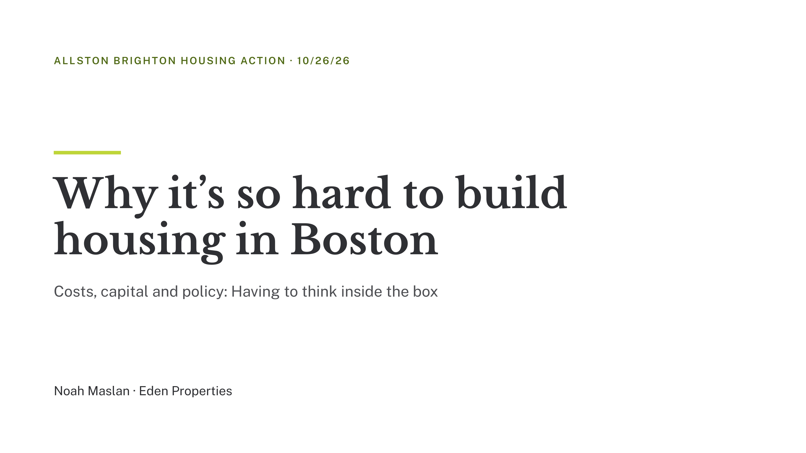
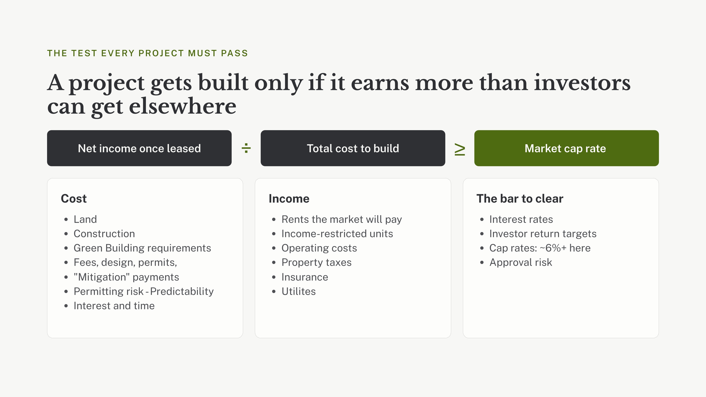
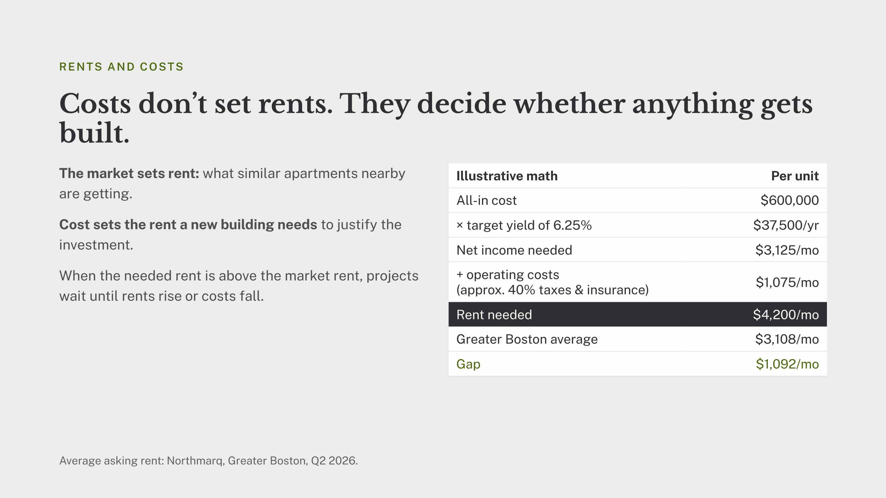
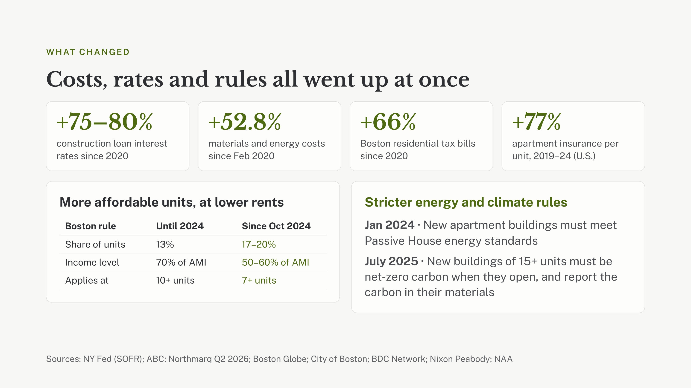
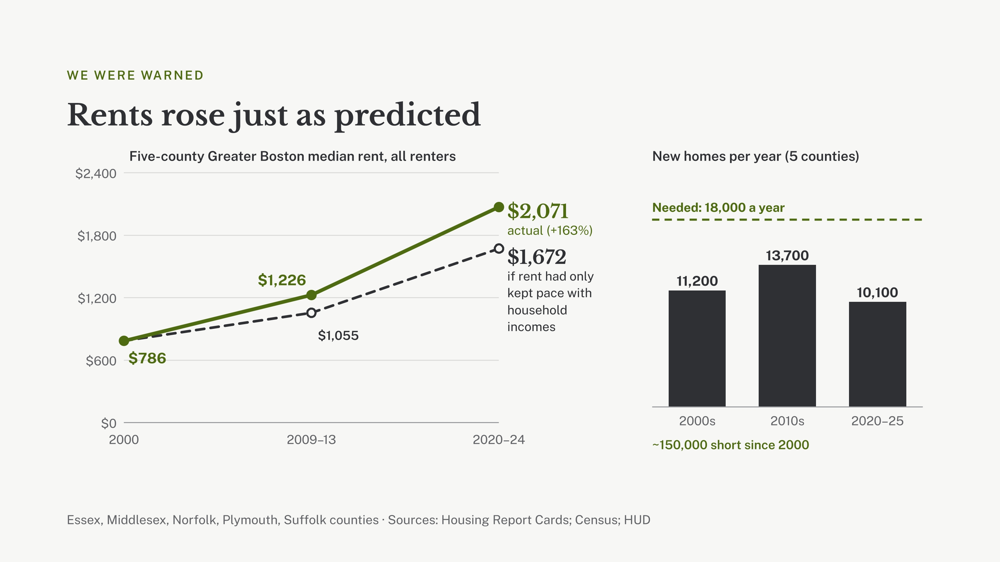
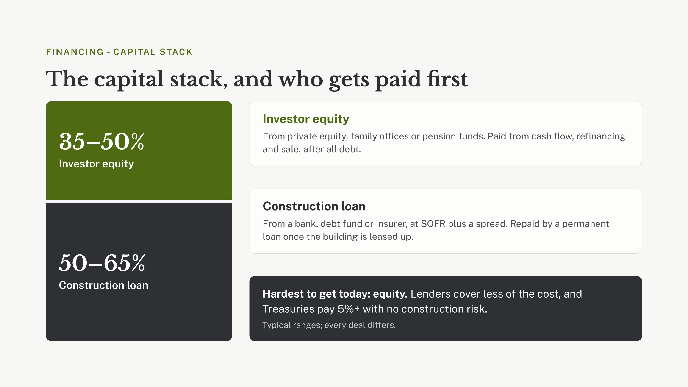
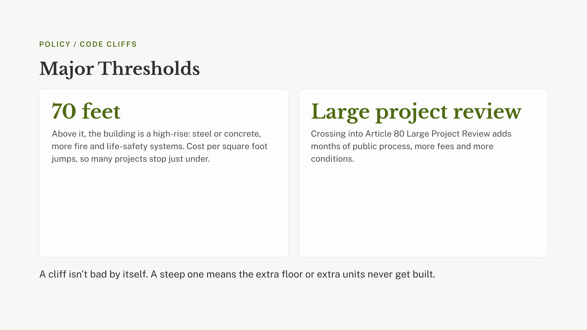
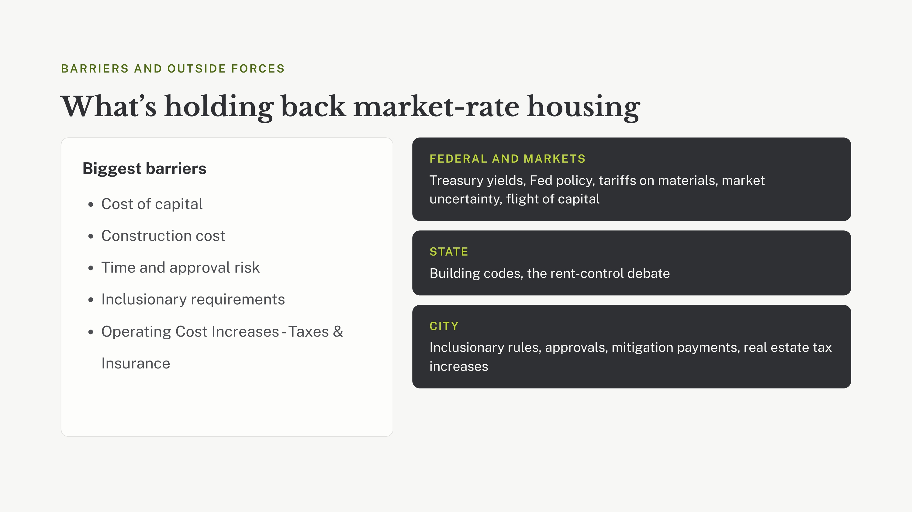
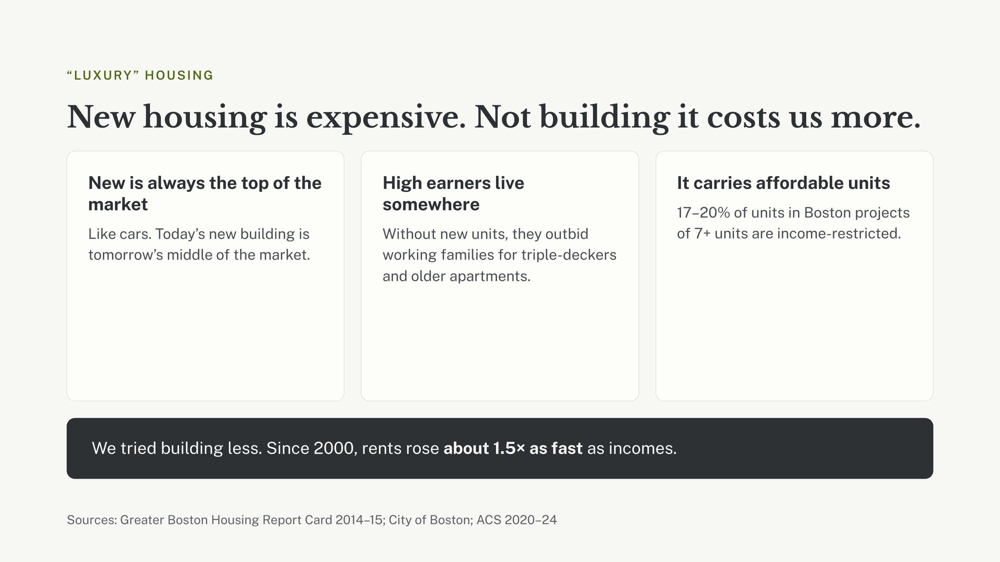
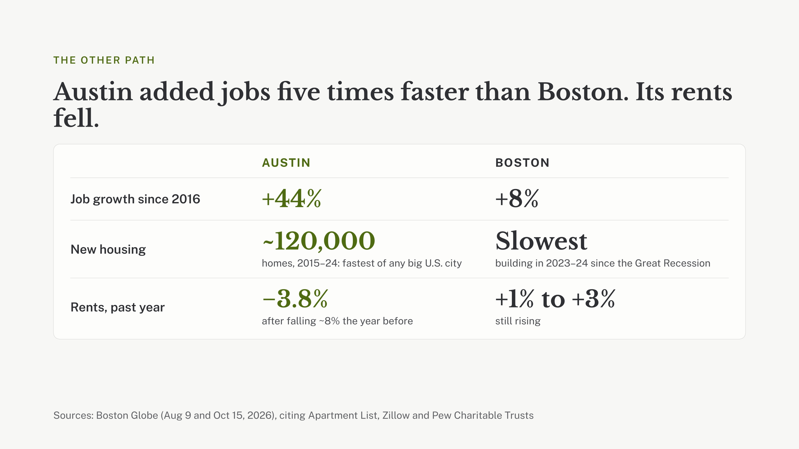
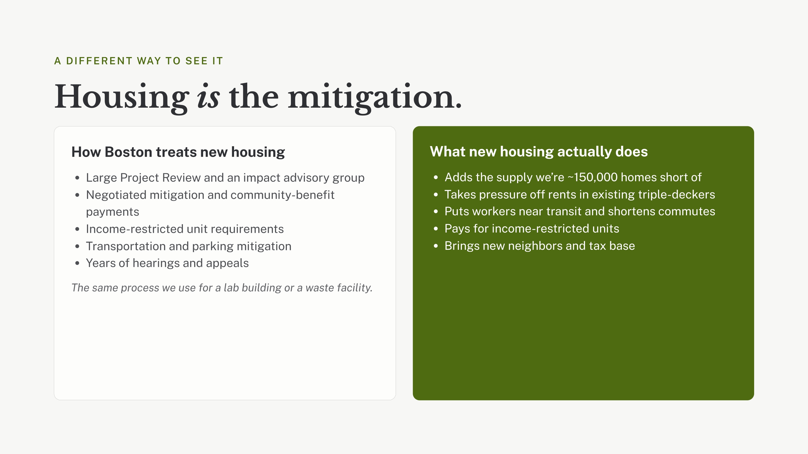
